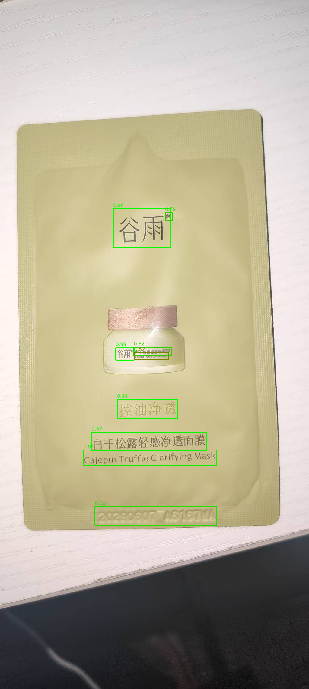

# DocVision

基于百度飞桨 **PaddleOCR** 的图片文字识别工具：上传图片，自动检测并识别图中文字，可视化检测框与置信度，一键导出 TXT。

> OCR 模型能力来自 PaddleOCR 官方预训练模型，本项目聚焦**模型调用、结果处理与工程封装**，不包含模型训练。



## 功能特性

- **图片文字识别**：上传图片即可检测 + 识别，支持中英文混排
- **检测框可视化**：识别结果画回原图，置信度越高框越绿，低置信度显示为橙色
- **置信度可控**：Web 界面提供阈值滑块，实时过滤低质量结果
- **结构化输出**：识别结果整理为「文字 / 置信度 / 坐标」表格
- **TXT 导出**：一键下载识别文本
- **双入口**：Web 界面（Gradio）+ 命令行工具

## 快速开始

### 1. 环境要求

- Python 3.10+
- 无需 GPU，CPU 即可运行

### 2. 安装

```bash
git clone https://github.com/<你的用户名>/DocVision.git
cd DocVision

python -m venv venv
# Windows
venv\Scripts\activate
# Linux / macOS
source venv/bin/activate

pip install -r requirements.txt
```

> 有 NVIDIA 显卡时可改装 GPU 版框架以加速：`pip install paddlepaddle-gpu`。代码无需任何修改，PaddleOCR 会自动检测设备。

### 3. 运行

**Web 界面**

```bash
python app.py
```

浏览器打开终端提示的地址（默认 <http://127.0.0.1:7860>），上传图片后点击「开始识别」。

**命令行**

```bash
python test_ocr.py examples/sample.png
```

输出识别结果，并生成 `examples/sample_result.txt` 与检测框标注图 `examples/sample_boxes.png`。

> 首次运行会自动下载模型权重（约需几十秒），之后使用本地缓存。模型文件不包含在本仓库中。

## 项目结构

```
DocVision/
├── app.py              # Gradio Web 界面
├── ocr_engine.py       # OCR 核心封装（模型管理 + 结果清洗）
├── image_utils.py      # 检测框可视化（置信度颜色映射）
├── test_ocr.py         # 命令行入口
├── requirements.txt    # 依赖清单
├── examples/           # 示例图片
├── assets/             # 演示截图
└── 项目讲解稿.md        # 项目设计说明与问答整理
```

## 实现说明

### 处理流程

```
图片输入 → 模型加载（懒加载） → 文字检测 → 文字识别
        → 结果清洗与结构化 → 检测框可视化 → TXT 导出
```

### 几个工程要点

**模型懒加载 + 单例**
模型加载到内存需 5~10 秒。`OCREngine` 在首次识别时才加载模型，之后复用同一实例，避免每次请求重复加载。

**结果清洗与结构化**
PaddleOCR 返回十余个字段，`recognize()` 将其提炼为统一的 `{text, score, box}` 结构，供界面与导出复用。

**坐标归一化**
检测框统一为 `[x1, y1, x2, y2]` 格式，并过滤检测误框出的空白区域。

**置信度可视化**
`image_utils.draw_boxes()` 按置信度线性映射颜色：高置信度偏绿、低置信度偏橙，便于快速判断结果可靠性。

## 技术栈

| 技术 | 用途 |
|---|---|
| Python 3.10 | 开发语言 |
| PaddleOCR / PaddlePaddle | OCR 模型推理 |
| OpenCV | 图像读写与检测框绘制 |
| Gradio | Web 交互界面 |

## 已知限制

- 未针对倾斜、透视变形的拍摄图做纠偏（可通过开启 `use_doc_unwarping` 改善，代价是耗时增加）
- CPU 单页推理约 10~20 秒，取决于图片中的文字块数量
- 不包含版面分析，输出为逐块文字，不还原段落层级

## 致谢与许可

- OCR 能力基于 [PaddleOCR](https://github.com/PaddlePaddle/PaddleOCR)（Apache License 2.0）
- 本项目遵循 [Apache License 2.0](LICENSE)
